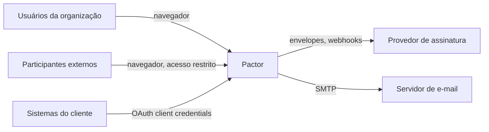
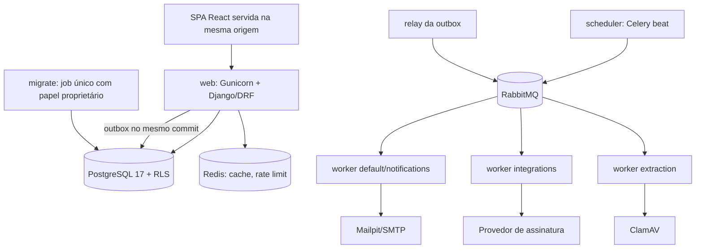
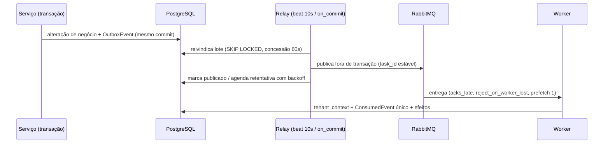
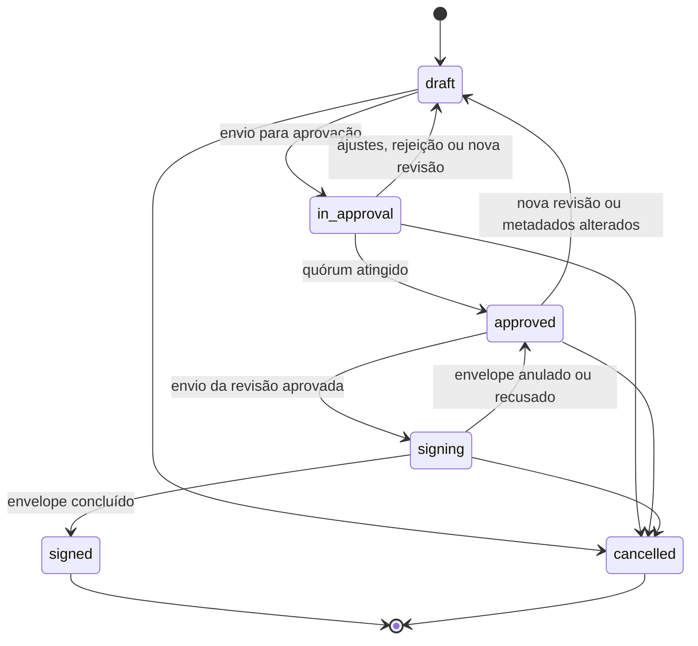
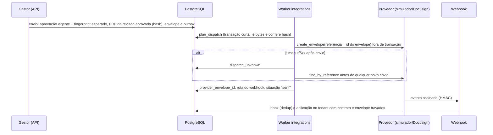
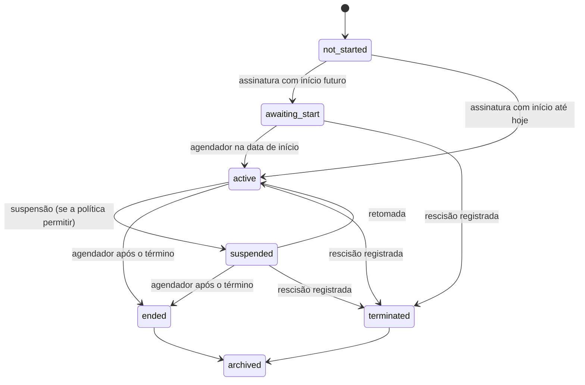
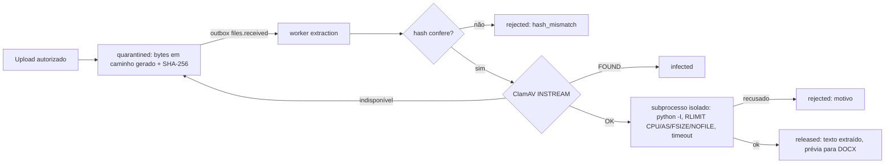

# Arquitetura

## C4 — Contexto

## C4 — Containers

## Processos

| Processo | Comando | Papel de banco |
| --- | --- | --- |
| `migrate` | `manage.py migrate` | `pactor_owner` |
| `web` | Gunicorn (`pactor.config.gunicorn`) | `pactor_app` |
| `worker*` | `celery worker` por fila | `pactor_app` |
| `scheduler` | `celery beat` | `pactor_app` |

## Contextos e módulos

| Módulo | Responsabilidade |
| --- | --- |
| `pactor.core` | Tenancy no banco, outbox, consumidores, idempotência, erros, observabilidade, health |
| `pactor.access` | Políticas puras (papéis, permissões, visibilidade) e base das views por tenant |
| `pactor.identity` | Usuários, organizações, departamentos, equipes, associações e convites |
| `pactor.plans` | Planos comerciais, trial e limites (assinatura da organização no Pactor) |
| `pactor.audit` | Trilha de auditoria somente-inserção e bloqueios de retenção |
| `pactor.notifications` | Consumidores que enviam e-mails |

Regras de negócio ficam em módulos sem dependência de Django (`access/policies.py`)
ou em serviços com limites transacionais explícitos (`*/services.py`). Views apenas
validam entrada, chamam serviços e serializam a saída.

## Estratégia de isolamento entre organizações

Defesa em profundidade, da aplicação ao banco:

1. **Principal por requisição.** Após autenticar, `TenantScopedMixin.initial` relê a
   associação ativa do usuário na organização selecionada (sessão do servidor). Sem
   associação ativa, a requisição falha com `organization_not_selected`.
2. **Escopo explícito.** Toda consulta de serviço/selector filtra por
   `organization_id` do principal ou de `require_tenant()`.
3. **Policies.** Funções puras decidem permissões e visibilidade por contrato.
4. **RLS forçada.** Toda tabela de tenant tem `ENABLE` e `FORCE ROW LEVEL SECURITY`
   com a policy `tenant_isolation`:
   `organization_id = NULLIF(current_setting('pactor.tenant_id', true), '')::uuid`.
   Associações também são legíveis pelo próprio usuário (`pactor.user_id`), para
   listar suas organizações; escritas sempre exigem o tenant.
5. **Contexto local à transação.** O tenant é definido com
   `set_config('pactor.tenant_id', ..., true)` dentro da transação da requisição
   (`ATOMIC_REQUESTS`) ou de `tenant_context()`. Ao terminar a transação, o valor
   expira; conexões reutilizadas não herdam tenant. Ausência de contexto ⇒ zero linhas.
6. **FKs compostas.** Referências entre tabelas de tenant usam
   `(organization_id, <fk>) → (organization_id, id)`, impedindo vínculos entre
   organizações mesmo com erro de escopo no código.
7. **Papel sem privilégios.** `pactor_app` não é superuser, não tem `BYPASSRLS` e não
   é dono das tabelas (não pode desabilitar RLS).

Testes de integração percorrem o catálogo do PostgreSQL e falham se alguma tabela de
tenant estiver sem RLS forçada ou se alguma FK entre tabelas de tenant não for composta.

Tabelas globais (sem RLS): usuários, organizações, planos, sessões, outbox e registros
de consumo. A outbox contém apenas identificadores; consumidores reconstituem o tenant
antes de ler entidades.

## Matriz de permissões

`✔` concedido pelo papel; `MFA` exige autenticação multifator na sessão.
Permissões de contrato dependem ainda da visibilidade do contrato (abaixo).

| Permissão | Prop. | Admin | Gestor | Solic. | Revisor | Aprov. | Financ. | Auditor |
| --- | --- | --- | --- | --- | --- | --- | --- | --- |
| members.manage | MFA | MFA | | | | | | |
| organization.manage / billing.manage | MFA | | | | | | | |
| integrations.manage / workflows.manage | MFA | MFA | | | | | | |
| operations.reprocess | MFA | MFA | | | | | | |
| audit.read | ✔ | ✔ | | | | | | ✔ |
| counterparties.read | | | ✔ | ✔ | ✔ | ✔ | ✔ | ✔ |
| counterparties.write | | | ✔ | | | | | |
| requests.create | | | ✔ | ✔ | | | | |
| requests.manage | | | ✔ | | | | | |
| templates.manage | | | ✔ | | | | | |
| contracts.read | | | ✔ | | ✔ | ✔ | ✔ | ✔ |
| contracts.create / submit / lifecycle / share | | | ✔ | | | | | |
| contracts.edit | | | ✔ | | ✔ | | | |
| contracts.comment | | | ✔ | ✔ | ✔ | ✔ | | |
| approvals.vote | | | | | | ✔ | | |
| signatures.send | | | ✔ | | | | | |
| obligations.manage | | | ✔ | | | | | |
| obligations.complete | | | ✔ | ✔ | | | ✔ | |
| finance.read | | | ✔ | | | | ✔ | |
| finance.write | | | | | | | ✔ | |
| reports.read | | | ✔ | | | | ✔ | ✔ |

Participantes externos: `contracts.read`, `contracts.comment` e `obligations.complete`,
apenas nos contratos compartilhados explicitamente com eles.

### Visibilidade de contratos

| Classificação | Quem enxerga (além de vínculo direto) |
| --- | --- |
| Interno | Quem tem `contracts.read` |
| Restrito | Gestor de contratos, auditor e membros do departamento do contrato com `contracts.read` |
| Confidencial | Somente vínculo direto |

Vínculo direto: concessão ao usuário ou a uma equipe dele, responsável, solicitante ou
aprovador de rodada ativa. Proprietário e administrador **não** enxergam contratos pelo papel.

## Processamento assíncrono

- Falha entre commit e publicação: o evento permanece `pending` e o relay periódico publica.
- Queda do relay após publicar: a concessão expira, o evento é republicado e o consumidor
  deduplica por `(consumidor, evento)`.
- Consumidores transacionais aplicam efeitos e registram consumo no mesmo commit (efeito
  único). Consumidores com efeito externo (e-mail) registram consumo após o efeito: garantia
  de pelo menos uma vez, com deduplicação nas repetições posteriores.
- Retentativas: até 6, backoff exponencial (5s a 10min). Falhas ficam em `ConsumerFailure`.
- Cada task fecha conexões antigas antes e depois e abre o tenant do evento.

## Contratos, rascunho e revisões

- **Rascunho** (`ContractDraft`): único por contrato, editável, com `version` para
  concorrência otimista (`UPDATE ... WHERE version = esperado`; zero linhas ⇒ `stale_version`).
- **Revisão** (`Revision`): publicada a partir do rascunho exigindo a versão do rascunho que
  o autor viu. Guarda conteúdo, SHA-256 do conteúdo, snapshot de metadados relevantes,
  anexos (com hash), autor, data, revisão anterior e **fingerprint** do conjunto submetido.
  Um trigger no banco impede `UPDATE` e `DELETE`.
- **Fingerprint**: SHA-256 do JSON canônico com hash do conteúdo, metadados (título, tipo,
  contraparte e documento, papéis das partes, departamento, classificação, valor, datas,
  contrato principal) e anexos. Identifica os bytes e dados registrados; não substitui
  assinatura digital nem constitui comprovação jurídica independente.
- **Bloqueio**: publicação, alteração de metadados e compartilhamento travam a linha do
  contrato (`SELECT ... FOR UPDATE` sem joins); relações são lidas depois do lock para não
  usar dados anteriores a um commit concorrente.
- **Comparação**: textual, por linhas (`difflib`); não há comparação semântica.
- **Referências**: `CT-<ano>-<sequência>` por organização, com numerador travado.

## Aprovações

- **Workflow versionado** (`WorkflowDefinition`): regras ordenadas; cada regra tem condições
  (campo permitido + operador permitido + valor tipado) e etapas. A última regra é a padrão,
  sem condições. Publicar cria nova versão e desativa a anterior; não há edição in-place.
- **Campos permitidos**: `contract_type`, `department_id`, `classification`, `confidentiality`
  (operadores `eq`, `ne`, `in`, `not_in`) e `total_value` (`eq`, `ne`, `gt`, `gte`, `lt`, `lte`).
  Valores lidos do snapshot da revisão submetida. Não há `eval` nem expressões.
- **Rodada** (`ApprovalRound`): vinculada à revisão, ao fingerprint, à versão do workflow e
  ao snapshot da regra usada. Uma rodada aberta por contrato.
- **Etapas**: mesmo `order` ⇒ paralelas; `order` crescente ⇒ sequenciais. Quórum por etapa.
- **Votos**: `aprovar`, `rejeitar` ou `solicitar ajustes`, com revisão e fingerprint gravados.
  Restrições no banco: uma vaga vota uma vez; uma pessoa vota uma vez por etapa (impede dupla
  contagem por delegação); votos são somente-inserção.
- **Delegação**: intervalo semiaberto `[início, fim)`, revogável, sem sobreposição; o delegado
  precisa ser aprovador ativo. Voto por delegação registra vaga (`approver`) e autor (`cast_by`).
- **Autoaprovação**: quando proibida, autor da revisão e solicitante não votam nem por delegação.
- **Perda de acesso**: vagas de quem perdeu associação ou papel não contam como elegíveis; a
  etapa fica `blocked` se o quórum se tornar inatingível, até a substituição auditada do
  aprovador (`replace-approver`). Votos já registrados são preservados.
- **Disputa com nova revisão**: voto e publicação travam o contrato. Se o voto vem antes, a
  publicação seguinte invalida a aprovação; se a publicação vem antes, a rodada é substituída
  e o voto é recusado. Testado nas duas ordens com conexões separadas.
- **Envio para assinatura** exige `approved`, revisão aprovada igual à vigente e fingerprint
  idêntico, sem rodada aberta (`require_approved_for_signature`).

## Assinaturas eletrônicas

- **Porta** (`signatures/ports.py`): criar, consultar por referência, consultar situação, cancelar,
  baixar documentos e interpretar webhooks. Adaptadores: **simulador** (local, determinístico,
  identificado em todos os documentos, recusado em produção) e **Docusign** (eSignature REST v2.1,
  JWT Grant, campo customizado `pactor_reference`, Connect com HMAC).
- **Revisão estável**: o envelope guarda revisão, fingerprint, provedor e conta. O PDF é gerado da
  revisão **aprovada** e armazenado com SHA-256 no envio; o worker envia exatamente esses bytes
  (hash conferido na leitura) e recusa o envio se a aprovação mudou.
- **Participante × envelope**: assinatura de um participante não conclui o envelope.
- **Eventos**: inbox com chave de deduplicação do provedor; situações só avançam (eventos fora de
  ordem não regridem); eventos de envelope cancelado, com falha, substituído ou de revisão diferente
  da aprovada são registrados como `old_envelope` e não alteram o contrato.
- **Documentos**: enviado, assinado e evidências são preservados separadamente, cada um com hash;
  downloads passam por autorização do contrato e conferem o hash antes de entregar os bytes.
- **Recuperação**: `reconcile` (periódico) consulta o provedor para envelopes sem confirmação ou sem
  eventos recentes; `process_pending_events` reaplica eventos gravados e não processados.

## Modelos de contrato e solicitações

- **Modelo** (`ContractTemplate`): rascunho da definição com concorrência otimista; **versões**
  (`TemplateVersion`) são publicadas como novas linhas somente-inserção.
- **Definição**: campos tipados (`text`, `date`, `decimal`, `boolean`, `choice`), seções com
  marcadores `{{chave}}` e seções opcionais condicionadas a um campo booleano. Qualquer outra
  sintaxe entre chaves é recusada na validação; não há expressões, filtros ou execução de código.
  A substituição é feita em uma única passagem: valores do usuário entram como texto literal.
- **Geração**: valida os dados contra a versão do modelo, renderiza o texto e publica uma nova
  revisão (`source = template`) que registra a versão do modelo e os dados canônicos usados.
  Publicar outra versão do modelo não altera revisões existentes (imutáveis).
- **Solicitações** (`ContractRequest`): `submitted → in_review → converted` (ou `rejected` /
  `cancelled`), com histórico somente-inserção. Solicitantes veem apenas as próprias; gestores
  veem todas. A conversão cria o contrato preservando solicitante, contraparte, valor e datas.

## Vigência, aditivos e encerramento

- Situação de vigência é separada da elaboração e da assinatura; o banco impede vigência sem
  assinatura (`contract_lifecycle_requires_signature`).
- Datas de vigência são locais da organização (`zoneinfo`, fuso configurado) e os limites são
  inclusivos: o contrato vale do dia de início ao dia de término. Término vazio = indeterminado.
- O agendador (`pactor.deadlines.daily_cycle`, de hora em hora, após as renovações automáticas) é idempotente e recupera
  indisponibilidades: se início e término já passaram, registra as duas transições.
- Ações manuais (suspender, retomar, rescindir, arquivar) exigem permissão, justificativa e data
  de efeito, e geram histórico somente-inserção (`LifecycleEvent`) e auditoria.
- **Aditivos** são contratos do tipo `amendment` ligados ao principal. Suas alterações
  (`AmendmentChange`: valor total, término, descrição) fazem parte do snapshot aprovado e
  assinado do aditivo e só valem depois da assinatura. O contrato original nunca é reescrito:
  `conditions_at` aplica, em ordem (data de efeito, ordem de registro), as alterações efetivas
  na data consultada.
- **Limite do plano**: contratos aguardando início, vigentes, suspensos ou em assinatura contam
  como ativos; o envio para assinatura é bloqueado ao exceder o limite.

## Arquivos

- **Formatos**: PDF e DOCX, identificados por extensão e conferidos pelos bytes iniciais.
- **Limites**: tamanho de upload (`PACTOR_MAX_UPLOAD_BYTES`), cota de armazenamento do plano,
  500 páginas, 2.000 entradas ZIP, 100 MiB descompactados, taxa de compressão 200:1, 2 milhões
  de caracteres extraídos.
- **Rejeições**: PDF criptografado, com JavaScript, `/Launch`, arquivos embutidos, RichMedia ou
  XFA; DOCX com macros (parte VBA ou tipo `macroEnabled`), relacionamentos externos
  (`TargetMode="External"`), caminhos absolutos ou com `..`, bombas de compressão; estrutura
  malformada; tempo ou memória excedidos no subprocesso.
- **Antimalware**: ClamAV real (container `clamav`, protocolo `INSTREAM`). Sem resposta `OK`
  explícita, o arquivo permanece em quarentena e a task tenta de novo; a indisponibilidade nunca
  libera arquivo.
- **Acesso**: arquivos fora de `released` não podem ser baixados, anexados, compartilhados nem
  ter texto extraído gravado (restrição no banco). Downloads exigem ser o autor do upload ou ter
  acesso a um contrato ao qual o arquivo está anexado; o hash é conferido antes da entrega.
- **Anexos**: arquivos liberados marcados como parte da submissão entram no fingerprint da
  revisão; anexar ou remover invalida aprovação vigente.

## Prazos, renovação, alertas e obrigações

**Política de prazos e cálculos** (`deadlines/calendar.py`):

| Tema | Regra |
| --- | --- |
| Âncora | Data de referência (término, início ou data fixa); o dia da âncora não é contado |
| Dias corridos | Deslocamento direto |
| Dias úteis | Exclui fins de semana (sábado e domingo) e feriados do calendário configurado |
| Ajuste | `none`, `following` (próximo dia útil) ou `preceding` (dia útil anterior) |
| Meses | Preserva o dia; quando o mês não tem o dia, usa o último (31/01 + 1 mês = 28/02 ou 29/02) |
| Recorrência | Sempre calculada a partir da data inicial e da sequência (não "encolhe" o dia) |
| Inclusividade | Vigência inclusiva nos dois limites; renovação vale no dia seguinte ao término |
| Fuso | Regras usam a data local da organização; alertas disparam às 08:00 locais (`zoneinfo`) |
| Feriados | Cadastrados pela organização; não há lista oficial embutida nem prazo legal presumido |

- **Renovação automática** só ocorre com política `automatic`, que registra quem autorizou e quando
  (restrição no banco). O ciclo diário executa renovações **antes** do encerramento automático;
  cada renovação registra término anterior, novo término e regra (`RenewalRecord`, somente-inserção).
  Não renovação registrada impede a renovação.
- **Alertas** são únicos por (alvo, tipo, data). O disparo marca o alerta como enviado e emite evento
  na outbox na mesma transação; alertas atrasados por indisponibilidade disparam uma única vez.
  O e-mail vai apenas a destinatários com associação ativa.
- **Obrigações** geram ocorrências estáveis por (obrigação, versão do cronograma, sequência) até um
  horizonte de 24 meses; regerar é idempotente. Mudança de cronograma cria nova versão, cancela
  pendentes futuras e preserva concluídas e submetidas. Conclusão exige evidência liberada quando
  configurado; dependência bloqueia conclusão enquanto houver pendência até a mesma data; aprovação
  de conclusão não pode ser feita por quem submeteu. Atraso é derivado da data local.
- **Agendamento** (`CELERY_BEAT_SCHEDULE`): relay da outbox (10 s), reconciliação de assinaturas
  (5 min), eventos pendentes (1 min), ciclo diário de contratos (1 h, idempotente) e alertas (1 min).
  Um teste garante que toda task agendada e todo consumidor roteado estão registrados.

## Valores e compromissos

- **Conceitos distintos**: valor contratado (condição do contrato, com aditivos por data), projeção
  (parcelas e marcos não cancelados), obrigação de pagamento (previstas vencidas não confirmadas) e
  confirmação (registro informado por usuário). Não há integração bancária nem conciliação.
- **Dinheiro**: `Decimal` com moeda explícita (BRL), `NUMERIC(14,2)`, sem negativos, até
  999.999.999.999,99. A API recusa números JSON (que chegam como `float`) e exige texto decimal.
  Arredondamento meio-par aplicado uma vez por operação.
- **Parcelas**: rateio exato (a soma é sempre o total; centavos restantes nas primeiras parcelas).
- **Índices**: valores percentuais com período (primeiro dia do mês), fonte e nota de origem
  registrados pela organização; séries podem ser marcadas como demonstrativas. Nenhum índice oficial
  é embutido ou inventado.
- **Reajustes** alteram apenas parcelas previstas a partir da data de efeito e registram antes/depois
  de cada parcela. Confirmações, valores de índice e reajustes são somente-inserção no banco.

## Pesquisa e relatórios

- **Motor**: busca textual do PostgreSQL (`tsvector`, configuração `portuguese`, índice GIN). Sem
  Elasticsearch: o volume esperado por organização e a necessidade de autorização por linha não
  justificam outro serviço.
- **Conteúdo indexado**: referência e título (peso A); contraparte, documento, etiquetas e
  classificação (B); conteúdo da revisão e texto extraído de anexos **liberados** (C).
- **Revisão correta**: cada evento de publicação indexa a revisão do evento. O upsert só grava se
  a revisão do job for igual ou mais nova que a indexada; um job atrasado nunca sobrescreve
  conteúdo mais recente. Mudanças de metadados ou anexos reindexam a revisão vigente.
- **Autorização antes do resultado**: a consulta parte de `visible_contracts(principal)`; total,
  página, snippets (`ts_headline`), facetas, sugestões, painel e exportação CSV são calculados
  somente sobre esse conjunto. Paginação limitada (até 50 por página, 100 páginas) com ordenação
  determinística (relevância, referência, id).
- **Exportação**: CSV com neutralização de fórmulas (células iniciadas por `= + - @`), até 5.000
  linhas, exige `reports.read`.

## Integrações máquina a máquina

- **Fluxo**: OAuth 2.0 *client credentials* (Django OAuth Toolkit). Apenas os endpoints de token
  (`/o/token/`, `/o/revoke_token/`) são expostos; aplicações são criadas pela API do Pactor por quem
  tem `integrations.manage` (com MFA). O segredo é exibido uma única vez e armazenado como hash.
- **Tenant explícito**: cada aplicação tem rota global (aplicação → organização → cliente). O
  principal da integração é resolvido a partir do token, vincula a transação ao tenant e só existe
  enquanto o cliente não estiver revogado (revogar apaga tokens emitidos).
- **Papéis e escopos**: o cliente recebe papéis operacionais (nunca proprietário/administrador) e uma
  lista de escopos permitida; o token concede no máximo esses escopos. Permissões efetivas =
  papéis ∩ escopos do token, e a visibilidade por contrato continua valendo.
- **Transporte**: token aceito somente no cabeçalho `Authorization: Bearer`; resposta 401 com
  `WWW-Authenticate: Bearer` quando ausente ou inválido. Tokens expiram em 1 hora, sem refresh.
