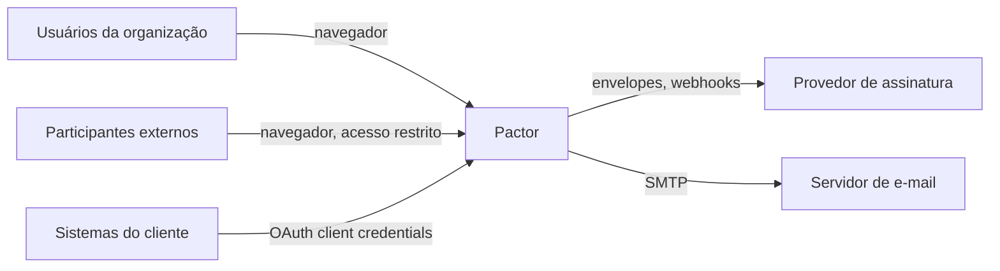
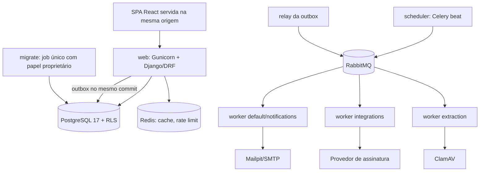

# Arquitetura

## C4 — Contexto

## C4 — Containers

## Processos

| Processo | Comando | Papel de banco |
| --- | --- | --- |
| `migrate` | `manage.py migrate` | `pactor_owner` |
| `web` | Gunicorn (`pactor.config.gunicorn`) | `pactor_app` |
| `worker*` | `celery worker` por fila | `pactor_app` |
| `scheduler` | `celery beat` | `pactor_app` |
